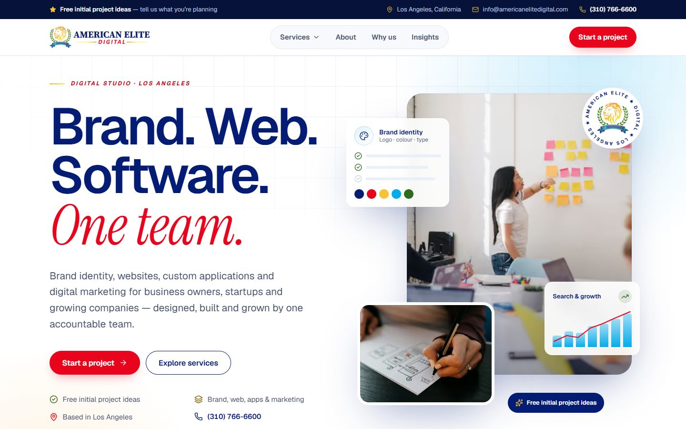
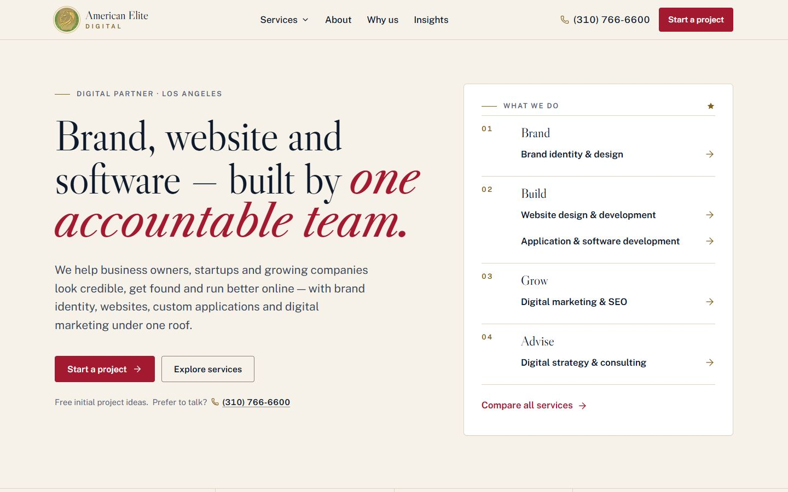
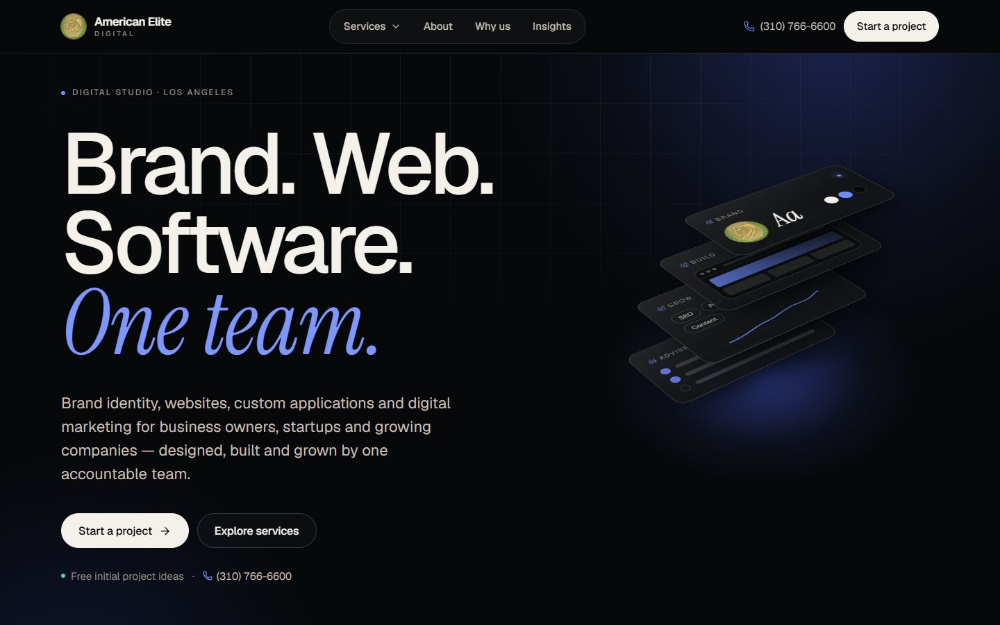

# Design direction

This file records three decisions:

- **v3, "American Elite"** (current, 2026-10-24): a light design built from the owner's logo.
- **v2, "Obsidian Atelier"** (superseded): a dark premium redesign.
- **v1, "American Editorial"** (superseded): the first rebuild.

v1 and v2 are kept below for history. Their content rules (no fake proof, facts only, nothing hidden behind hover) still apply.

## v3 — owner direction

The owner supplied the official logo and asked for three changes:

1. Use the logo's colours throughout the site.
2. Move away from the dark v2 design, which they found too dark.
3. Make the site modern, advanced and professional, with images, animation and effects.

Everything else carried over unchanged: routes, the inquiry backend, SEO, feature flags (pricing stays hidden), the motion system's reduced-motion and no-JavaScript guarantees, and the no-fabrication rules.

## v3 — what the logo gives the system

The colours were sampled from the artwork (see `design-system.md` §1).

| Logo element | Colour | Role on the site |
|---|---|---|
| "AMERICAN ELITE" wordmark | Navy `#041C74` | Headings, links, secondary buttons, the brand voice |
| "DIGITAL" | Red `#E8041C` | Primary buttons, eyebrow labels, serif accent phrases |
| Lion and the rules either side of "DIGITAL" | Gold `#F4AC34` → `#F9EB3B` | Gold rules, the star pattern, step markers, highlights, the primary button on navy |
| Ribbon | Sky blue `#04ACEC` | Background light fields, charts, focus glow |
| Laurel | Green `#2C6C1C` | Success states and check marks |

**Motifs taken from the logo:**

- **Eyebrow labels** copy the "— DIGITAL —" lockup: red italic tracked caps after a short gold gradient rule.
- **The ribbon's stars** become a faint gold star pattern on navy bands and gold stars in the service marquee.
- **The emblem** (lion, laurel, ribbon) appears as a spinning badge in the hero, a "Part of American Elite Enterprises" card, a watermark in the call-to-action band, and the favicon.

## v3 — composition

- **Surfaces:** white and a cool paper tint (`#F5F8FD`) carry most of the site. Navy is used for rhythm and weight in five places only: the utility bar, the service marquee, the homepage "Why" section, the call-to-action band and the footer. Each navy band remaps the tokens (`.surface-navy`): white text and gold accents.
- **Header:** a navy utility bar (free initial ideas, location, email, phone) scrolls away, while the white main bar with the logo lockup stays pinned. The bar starts transparent over the hero and turns solid white with a soft shadow on scroll.
- **Hero:**
  - The headline is "Brand. Web. Software. *One team.*" in navy, with the accent in red serif italic.
  - A photo collage: a workshop photo, a wireframe-sketch inset, and two floating UI cards (brand identity, search & growth) showing abstract content with no figures.
  - An offer pill and the spinning emblem badge.
  - Layers move at different depths with the pointer.
- **Photography:** each practice card, inner-page header and several sections now carry a photo. Sources and rules are in `image-credits.md`.
- **Cards:** white, with soft navy-tinted shadows. They lift on hover, and a gold-to-sky cursor spotlight lights their border.
- **Typography:** Geist in navy for headings (600 weight), with the Instrument Serif italic accent in red.

### Before and after (v2 → v3)

Screenshots are in [`screenshots/`](screenshots/). They show the first screen only, at 1440 × 900 and 390 × 844, with reduced motion so everything has settled.

| Page | v2 desktop → v3 desktop | v2 mobile → v3 mobile |
|---|---|---|
| Home | [v2](screenshots/home-desktop-after.jpg) → [v3](screenshots/home-desktop-v3.jpg) | [v2](screenshots/home-mobile-after.jpg) → [v3](screenshots/home-mobile-v3.jpg) |
| Services | [v2](screenshots/services-desktop-after.jpg) → [v3](screenshots/services-desktop-v3.jpg) | [v2](screenshots/services-mobile-after.jpg) → [v3](screenshots/services-mobile-v3.jpg) |
| Service page (web) | [v2](screenshots/service-web-desktop-after.jpg) → [v3](screenshots/service-web-desktop-v3.jpg) | [v2](screenshots/service-web-mobile-after.jpg) → [v3](screenshots/service-web-mobile-v3.jpg) |
| About | [v2](screenshots/about-desktop-after.jpg) → [v3](screenshots/about-desktop-v3.jpg) | [v2](screenshots/about-mobile-after.jpg) → [v3](screenshots/about-mobile-v3.jpg) |
| Contact | [v2](screenshots/contact-desktop-after.jpg) → [v3](screenshots/contact-desktop-v3.jpg) | [v2](screenshots/contact-mobile-after.jpg) → [v3](screenshots/contact-mobile-v3.jpg) |
| Article | [v2](screenshots/article-desktop-after.jpg) → [v3](screenshots/article-desktop-v3.jpg) | [v2](screenshots/article-mobile-after.jpg) → [v3](screenshots/article-mobile-v3.jpg) |
| 404 | [v2](screenshots/not-found-desktop-after.jpg) → [v3](screenshots/not-found-desktop-v3.jpg) | [v2](screenshots/not-found-mobile-after.jpg) → [v3](screenshots/not-found-mobile-v3.jpg) |

In the v1 → v2 table further down, "before" is v1 and "after" is v2.

---

## v2 (superseded) — why the visuals were reset

v1 fixed the site's structure, accessibility, SEO and speed. Visually it was correct but quiet: ivory paper, Caslon, gold rules, CSS-only fades. The v2 brief asked for a premium agency feel with these specific changes:

- a new colour system, not gold/crimson/navy and not purple gradients;
- a distinctive hero;
- a real motion system that respects reduced motion;
- stronger typography and art direction on every route.

**Constraints carried over unchanged from v1:**

- no invented clients, results, logos, reviews or metrics;
- packages stay hidden until prices are verified;
- routes, redirects, the inquiry backend, spam protection, SEO, feature flags and env var names are all preserved.

**Content reality (unchanged):**

- strong service copy and four articles;
- no portfolio, no testimonials and no team or project photography.

Any direction that depends on imagery or proof would have to fake it.

## v2 (superseded) — three directions considered

The brief proposed the three starting points.

### A. Obsidian Digital Atelier

- **Look:** near-black surfaces, warm white type, an electric cobalt accent, fine borders, refined depth, subtle ambient light.
- **Motion:** cinematic but understated.
- **Typography:** editorial, with generous spacing.

### B. Contemporary Editorial Studio

- **Look:** warm off-white and ink, a striking display face, oversized type, unconventional grids.
- **Art direction:** carried by strong imagery.
- **Risk:** it's closest to v1, so the least change for the owner. Its premium feel also depends on art-directed photography and project imagery, which the site doesn't have.

### C. Experimental Creative Technology

- **Look:** dark surfaces with bright controlled accents.
- **Hero and storytelling:** an interactive hero, motion-driven storytelling, layered imagery, experimental layouts.
- **Risk:** the expressive motion and layered visuals cost JavaScript and GPU time. Mobile LCP was already the tightest metric (about 3 s in the mobile lab profile).

## v2 (superseded) — evaluation

Scores are 1–5, higher is better.

| Criterion | A. Obsidian Atelier | B. Editorial Studio | C. Creative Technology |
|---|---|---|---|
| Visibly different from v1 and from the old WordPress site | **5** | 2 — same family as v1 | 5 |
| Premium without imagery or proof the site lacks | **5** — light, depth and type carry it | 2 — needs art-directed photography | 3 — layered imagery would be stock or decoration |
| Clarity of the commercial message | **5** | 4 | 3 — experimental layouts compete with the offer |
| Accessibility (contrast, motion, readability) | **5** — high-contrast bone on obsidian; motion is decorative only | 5 | 3 — heavy motion, harder to keep calm |
| Performance budget (mobile) | **4** — CSS-first motion, one small runtime | 5 | 2 — WebGL or a motion library on every page |
| Consistency across all routes, legal pages and articles | **5** | 4 | 2 |
| **Total** | **29** | 22 | 18 |

## v2 (superseded) — decision: A, "Obsidian Atelier"

Only A is premium with the content that exists today. It is also clearly a new identity rather than a restyle of v1, and it keeps motion inside the performance budget.

**Borrowed from C:** a single idea, kept within A's restraint — a **dimensional hero composition** (the CSS 3D "stack", described below). It has no WebGL, no imagery and no claims, and it is the only expressive element on the site. No other C traits (experimental layouts, layered imagery) and no B traits were mixed in.

### What it looks like

- **Surfaces:**
  - Obsidian (`#07080A`) is the page.
  - Two raised steps (`#0E1013`, `#15181D`) build depth instead of shadows.
  - Hairlines are 9–18% bone.
  - A faint masked grid and two blurred cobalt light fields ("aurora") sit behind page headers.
- **Type:**
  - **Geist** (variable) sets everything: tight negative tracking at display sizes, up to 124 px on the home hero.
  - **Instrument Serif italic** in cobalt is the accent voice for one phrase per headline, for example "*One team.*", plus index numerals.
- **Colour:**
  - Bone text (`#F4F1EA`) on obsidian.
  - One accent, cobalt (`#6E8BFF`), used for emphasis, links, focus and state, never as a large fill.
  - The primary button is a bone pill with ink text, the brightest object on any screen. This keeps the CTA unmistakable without a loud colour.
- **Brand:**
  - The heraldic crest stays as a small seal beside the "American Elite / DIGITAL" wordmark.
  - The full original logo still appears on About under "Our mark".
  - Gold, crimson and navy are retired from the UI but live on inside the crest artwork itself.
- **Hero:**
  - A three-line headline, "Brand. Web. / Software. / *One team.*". Each line slides out of its own mask.
  - Beside it, **"The Stack"**: four slabs in CSS 3D (Advise, Grow, Build, Brand), one per practice. They tilt a few degrees toward the pointer.
  - The stack is decorative (`aria-hidden`), and the same information appears as text right below.
  - Its slabs show abstract UI (bars, a type specimen, a trend line) but **no numbers, logos or claims**.
- **Section language:**
  - a scroll-linked service ticker;
  - spotlight cards (a cursor light shared across a group);
  - bento grids for "at a glance" and outcomes;
  - a process rail whose beam fills as you scroll;
  - statement paragraphs that "ink in" from grey to bone as they scroll through;
  - a giant outlined wordmark in the footer.
- **Motion:** a token-based system (timing, easing, distance, stagger), mostly CSS, plus one client runtime of about 1 KB gzipped. All of it switches off under `prefers-reduced-motion`, and none of it hides content if it fails. Details are in `design-system.md` §6.

### Deliberately avoided

- **Purple-to-pink gradients, glassmorphism and continuous background animation.** The hero light only drifts after the visitor interacts, and only on the homepage.
- **WebGL, shader backgrounds and animation libraries.** See `component-selection.md`.
- **Fake proof.** There are no counters, logos, testimonials or "trusted by" strips. The bento "at a glance" cells state only facts the business already publishes.
- **Scroll hijacking, scroll-jacked pinning and hidden-until-hover content.**

### Before and after

The screenshots were captured at the same moment from the v1 and v2 production builds: same viewport, reduced motion so every entrance has settled, first screen only. They are in [`screenshots/`](screenshots/).

| Page | Desktop (1440 × 900), v1 → v2 | Mobile (390 × 844), v1 → v2 |
|---|---|---|
| Home | [v1](screenshots/home-desktop-before.jpg) → [v2](screenshots/home-desktop-after.jpg) | [v1](screenshots/home-mobile-before.jpg) → [v2](screenshots/home-mobile-after.jpg) |
| Services | [v1](screenshots/services-desktop-before.jpg) → [v2](screenshots/services-desktop-after.jpg) | [v1](screenshots/services-mobile-before.jpg) → [v2](screenshots/services-mobile-after.jpg) |
| Service page (web) | [v1](screenshots/service-web-desktop-before.jpg) → [v2](screenshots/service-web-desktop-after.jpg) | [v1](screenshots/service-web-mobile-before.jpg) → [v2](screenshots/service-web-mobile-after.jpg) |
| About | [v1](screenshots/about-desktop-before.jpg) → [v2](screenshots/about-desktop-after.jpg) | [v1](screenshots/about-mobile-before.jpg) → [v2](screenshots/about-mobile-after.jpg) |
| Contact | [v1](screenshots/contact-desktop-before.jpg) → [v2](screenshots/contact-desktop-after.jpg) | [v1](screenshots/contact-mobile-before.jpg) → [v2](screenshots/contact-mobile-after.jpg) |
| Article | [v1](screenshots/article-desktop-before.jpg) → [v2](screenshots/article-desktop-after.jpg) | [v1](screenshots/article-mobile-before.jpg) → [v2](screenshots/article-mobile-after.jpg) |
| 404 | [v1](screenshots/not-found-desktop-before.jpg) → [v2](screenshots/not-found-desktop-after.jpg) | [v1](screenshots/not-found-mobile-before.jpg) → [v2](screenshots/not-found-mobile-after.jpg) |

---

## v1 record — "American Editorial" (superseded)

The colour, type and motion choices below were replaced in v2. The content rules (no fake proof, facts only, nothing hidden behind hover) still apply.

### v1 inputs

- **Brand equity worth keeping:** the American Elite crest (gold lion, green laurel, navy star ribbon on a crimson and gold field) and its palette of **gold, crimson and navy**. It signals heritage and "American" credibility. The problem was its execution: a raster crest in a bevelled frame on a `#FF0000` bar, not the idea behind it.
- **Content reality:** strong, specific service copy; four articles; no portfolio, testimonials, team photos or project imagery. The stock imagery is generic, and some of it has baked-in text.
- **Audience:** business owners, startups and growing companies judging whether this team is credible enough to trust with their brand, website or software.
- **Research (UI/UX Pro Max dataset):**
  - "B2B Service" points to Swiss and minimal styles, with credibility and clear ROI messaging.
  - "Creative/Marketing Agency" points to editorial and motion-led styles, and **requires case studies** to work.
  - Authority palettes for professional services pair **navy with a trust gold**.
  - Editorial Grid and Exaggerated Minimalism are recommended for agency landing pages, with high-contrast, oversized but readable type.
  - The search script couldn't run (no Python on this machine), so the dataset's CSVs were queried directly.
- **21st.dev MCP:** **not available in this session.** None of its tools were connected, so no 21st.dev components were searched or used. All components are original implementations on native HTML primitives.

### v1 directions explored

#### A. Editorial Digital Studio — "American Editorial"

- **Look:** warm ivory paper and navy ink. Oversized Caslon display headlines (the typeface family of early American printing, including the 1776 Declaration broadside) paired with a Franklin Gothic-lineage sans (Public Sans, the US government's open-source typeface).
- **Detail:** gold hairline rules, numbered sections, generous margins, and a restrained crimson used only for action.
- **Signature element:** a typographic **services index** in the hero (Brand · Build · Grow · Advise), which works as both the centrepiece and the navigation.

#### B. Premium Technology Partner — "Mission Control"

- **Look:** deep navy surfaces, precise 1px grids, monospaced labels, schematic diagrams and animated system illustrations.
- **Promise:** technical depth.
- **Risk:** it needs real product or interface work to show, and the site has none, so diagrams would become decoration posing as proof.

#### C. Contemporary Growth Agency — "Results Engine"

- **Look:** bold commercial headlines, big numbers, case-study-first layouts, high-energy colour blocks.
- **Risk:** its core assets (metrics, logos, case studies, testimonials) **don't exist**. Filling those slots would mean fabricating proof, which the brief forbids.

### v1 evaluation

Scores are 1–5, higher is better.

| Criterion | A. Editorial | B. Technology | C. Growth |
|---|---|---|---|
| Brand distinction (heritage crest, "American Elite" name) | **5** — Caslon and gold rules extend the crest naturally | 3 — generic tech look; discards the brand's heritage | 2 — looks like any growth agency |
| Credibility with the content available today | **5** — typography and specific copy carry it without imagery | 2 — implies product proof the site can't show | 1 — depends on fake metrics |
| Conversion potential | 4 — clear CTAs, services index, inquiry form on every key page | 4 | 5 in theory; fails without proof |
| Accessibility | **5** — high-contrast ink on paper (15.7:1), large type | 4 — dark UI is harder for low vision; thin mono labels | 4 |
| Performance | **5** — almost no imagery needed; CSS-only motion | 3 — animated diagrams cost JavaScript | 3 — heavy imagery and counters |
| Maintenance | **5** — new content is mostly text | 3 | 2 — every page needs bespoke visuals |
| Fit across all routes (legal, articles, services) | **5** — editorial suits long-form pages | 3 | 2 |
| **Total** | **34** | 22 | 19 |

### v1 decision: "American Editorial"

It's the only direction that is distinctive, honest about the available content, and excellent without imagery or motion.

It takes one disciplined idea from B: **precision**. That means a strict 12-column grid, hairline rules, tabular numerals and a monospaced-feeling label style built from Public Sans small caps rather than a third font. This doesn't mix styles; it executes the editorial idea precisely.

#### What it looks like

- **Surfaces:**
  - Ivory paper (`#F6F2EA`) is the default.
  - Deep navy (`#12284A`) is reserved for moments of emphasis: the "Why us" section, the inquiry band and the footer.
  - Navy sections invert the system (paper text, gold accents) and are never decorative backdrops.
- **Type:**
  - Libre Caslon Display for headlines (H1 hero up to 96px).
  - Libre Caslon Text italic for one or two emphasis words per headline, in gold on navy or crimson on paper.
  - Public Sans for everything else.
- **Brand mark:** the real crest (lion and laurel, cropped from the original logo) as a small circular seal beside a typographic wordmark — "American Elite" in Caslon over "DIGITAL" in tracked small caps. The full original logo appears on the About page under "Our mark", so the recognisable artwork is kept and presented properly.
- **Graphic language:**
  - hairline gold rules
  - section numerals ("01 / Brand")
  - a large gold star from the crest ribbon, used sparingly as a section terminator
  - pull-quote scale for key statements
  - No gradients, glassmorphism, floating blobs or emoji.
- **Imagery:** article featured images only, framed with a thin rule and a caption-style label. No stock photos on service pages; specific copy does the work.
- **Motion:** CSS only.
  - A one-time 560 ms rise-and-fade on the hero.
  - Scroll-driven reveals (`animation-timeline: view()`) that apply only where supported, and **never hide content when unsupported**.
  - 200 ms hover and focus transitions; the arrow nudges on links.
  - All of it is disabled under `prefers-reduced-motion`.

#### What we deliberately avoided

- Repeating three-card grids. Services render as an indexed list, process as a numbered rule-line sequence, and articles as an editorial list with one featured lead.
- Hidden-until-hover information. Every service row shows its contents at rest.
- Fake proof. The "proof" band states only facts the business already publishes: free initial project ideas, a Los Angeles address, membership of American Elite Enterprises, and brand, web, apps and marketing under one roof. Package-only guarantees (24-hour turnaround, money-back, ownership rights) appear only beside the packages they belong to. There are no invented numbers.
